# Birdsense — an overview

Birdsense is Eastside Audubon's web app for its bird-listening program.
Volunteers mount acoustic recorders ("listening stations") in local parks.
Every week or two someone pulls a recorder's SD card, and Birdsense takes it
from there: the card's recordings go up through the browser,
[BirdNET](https://birdnet.cornell.edu/) (Cornell's bird-call model) listens to
every second of them, volunteers review what it heard, and the public landing
page shows which species the program has heard lately.

This is a tour of how it fits together, written for people. It names the
moving parts, shows how they connect, and points to the documents that go
deeper. It leaves things out on purpose: when a detail matters, the design
docs listed at the end, and the code, have it.

**Contents**

1. [At a glance](#at-a-glance)
2. [Who uses it](#who-uses-it)
3. [The big picture](#the-big-picture)
4. [The life of a card](#the-life-of-a-card)
5. [The web app](#the-web-app)
6. [The frontend](#the-frontend)
7. [Uploading a card](#uploading-a-card)
8. [Analysis](#analysis)
9. [Reviewing detections](#reviewing-detections)
10. [What the public sees](#what-the-public-sees)
11. [The Detections tab and LLM tools](#the-detections-tab-and-llm-tools)
12. [Signing in](#signing-in)
13. [Data](#data)
14. [Background work](#background-work)
15. [Deployment](#deployment)
16. [Running it locally](#running-it-locally)
17. [Design principles, in short](#design-principles-in-short)
18. [Where to read more](#where-to-read-more)

---

## At a glance

| Concern | What Birdsense uses |
|---|---|
| Server | One Go binary that serves the JSON API *and* the frontend's static files |
| Frontend | Plain JavaScript web components: no framework, no bundler, no build step |
| Documents | Azure Cosmos DB (a single JSON file in development) |
| Audio and clips | Azure Blob Storage (a directory in development) |
| Uploads | The [tus](https://tus.io) resumable-upload protocol, with WAVs compressed to FLAC in the browser |
| Bird identification | BirdNET v2.4 in Python, plus Google's Perch v2 as an optional second opinion |
| Where analysis runs | The same Go binary, as `birdsense worker`, in a separate Container Apps job that scales to zero |
| Sign-in | Microsoft or Google (OpenID Connect), or a password set through an emailed link. The roster is the allow-list |
| LLM access | An MCP endpoint, with Birdsense as its own OAuth server |
| Hosting | Azure Container Apps, described entirely in Terraform |

## Who uses it

Everyone who signs in is on a **roster** that a coordinator keeps. Each person
has one or more roles, and the roles decide which tabs they see.

| Who | What they do | Where in the app |
|---|---|---|
| **Public visitor** | Sees the program's recent species and counts. No sign-in | The landing page, `/` |
| **Field volunteer** | Pulls cards from recorders, uploads them, resumes an upload that stopped | Upload, My uploads |
| **Reviewer** | Listens to groups of detections ("bouts") and says whether BirdNET was right. Browses every detection | Review, Detections |
| **Birding expert** | A reviewer who also sets the review rules, settles bouts reviewers disagree on, and can override any verdict | Disagreements, Review rules |
| **Admin** (coordinator) | Everything above, plus every card, the recorders and the roster | All uploads, Recorders, People |
| **LLM tool** | Reads detections as a reviewer would, for example to draft the weekly report | `/api/v1/mcp` |

Roles combine: one person can be a field volunteer and a reviewer. Admin is an
access level rather than a role, and an admin can do everything.

## The big picture

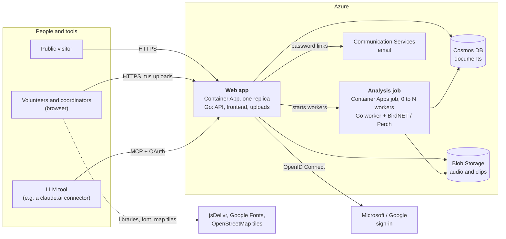

There are two programs, and they are the same binary:

- **The web app** answers every HTTP request: the pages, the API, the card
  uploads and the MCP endpoint. It also runs a few background loops (starting
  analysis, preparing cards for review, deleting old audio). It is small
  (half a vCPU) and always on.
- **The analysis workers** do the heavy lifting: they download a card's
  recordings, run BirdNET over them, cut a short audio clip of each detection,
  and store the results. They run only while there is work, then exit.

The two never talk to each other directly. They share the database and the
file store. In fact the database *is* the work queue: a card whose files are
waiting for analysis is the queue, with no separate queue service to keep in
step with it.

## The life of a card

Following one SD card from the recorder to the landing page touches nearly
every part of the system.

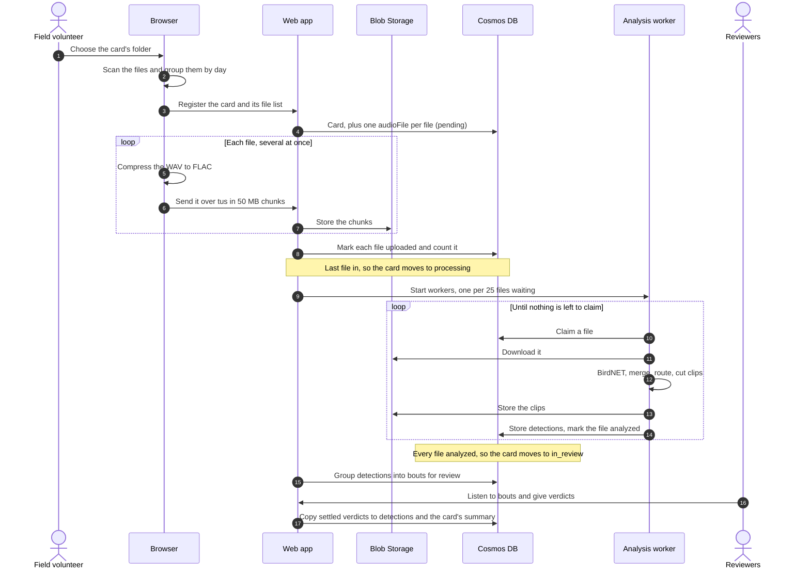

A card's **status** records where it is on that path:

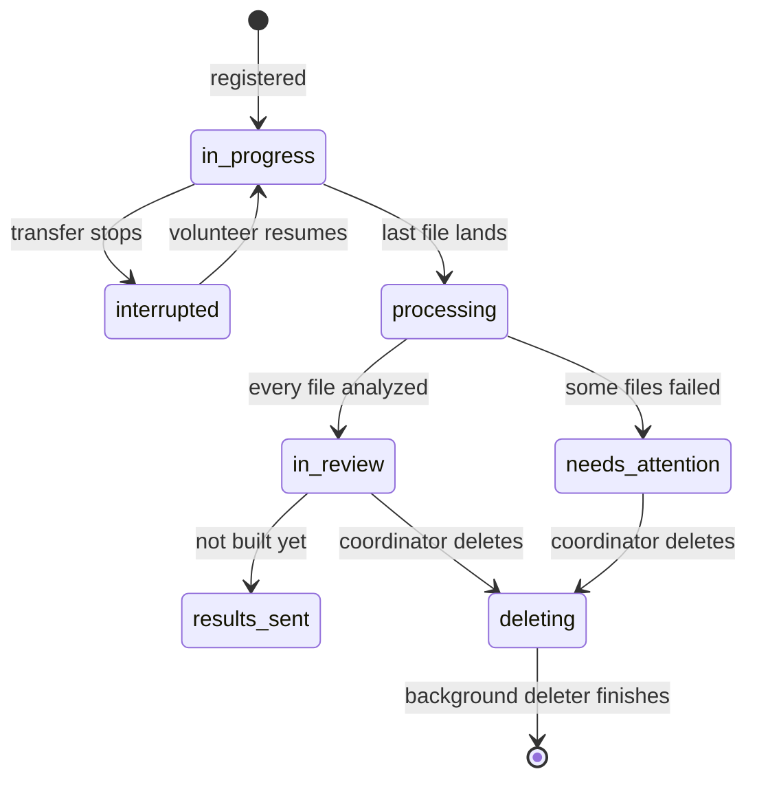

A coordinator can delete a card from any status, not only the two drawn. The
step to `results_sent` (closing a card and emailing its results) is designed
but not built yet.

## The web app

### What runs in the process

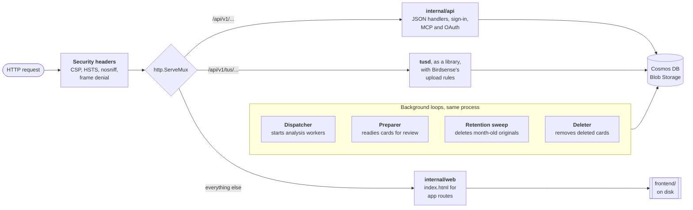

The web app is a standard Go `net/http` server. There is no router library and
no web framework; Go's own method-and-path patterns
(`"GET /api/v1/health"`) do the routing. Every response, API or page, passes
through one place that sets the security headers, so the content security
policy names every outside origin the frontend loads from in one spot.

The background loops live here because this is the one process that is always
running. Each wakes when something happens (a card lands, the rules are
saved, a card is deleted) and also on a timer as a backstop, so a missed wake
costs minutes, not data. See [Background work](#background-work).

### The API

The API lives under `/api/v1/`. Its responses are always JSON objects, never
bare arrays, so a response can gain fields without breaking anyone. Routes are
grouped by who may call them, and the server checks the caller's role on
every request; the frontend hiding a tab is only a convenience.

| Routes | For | What they do |
|---|---|---|
| `/health`, `/ready` | Azure's probes | Liveness (always 200) and readiness (can it reach the database and storage?) |
| `/public/overview` | Anyone | The landing page's numbers |
| `/session`, `/auth/...` | Signing in | Who you are, OIDC redirects, passwords |
| `/uploads`, `/tus/...`, `/speedtest` | Field volunteers | Register a card, send its files, see your own cards |
| `/detections/...` | Reviewers | List, filter, export and play detections |
| `/review/...` | Reviewers and birding experts | Bouts, verdicts, disagreements, the review rules |
| `/admin/...` | Admins | Every card, the recorders, the roster |
| `/mcp`, `/oauth/...`, `/.well-known/...` | LLM tools | The MCP server and the OAuth server that guards it |
| `/dev/...` | Development only | Sign in as anyone on the roster |

The full route list is in [CLAUDE.md](CLAUDE.md), under *The API is the same
shape the real one will be*.

### How the Go code is organized

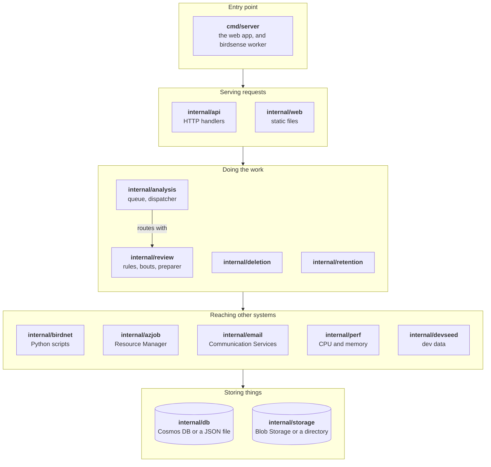

Each layer uses only the layers below it; the one dependency inside a layer
is `internal/analysis` routing detections with `internal/review`'s rules.
Nothing below `internal/api` knows about HTTP, and nothing but `internal/db`
and `internal/storage` knows which database or file store is behind them.

| Package | What it is |
|---|---|
| `cmd/server` | `main()`: reads configuration, opens the stores, wires the routes, starts the loops, shuts down gracefully. `birdsense worker` runs one analysis worker instead |
| `internal/api` | Every HTTP handler: cards, uploads, detections, review, admin, sign-in, MCP and OAuth |
| `internal/web` | Serves `frontend/` with cache and security headers, and falls back to `index.html` for app routes |
| `internal/db` | The data model and the `Store` interface, with two backends: Cosmos DB and a JSON file |
| `internal/storage` | Audio and clips: Azure Blob Storage, or a directory, behind one interface tusd can write to |
| `internal/analysis` | The analysis queue (claim, run, retry), and the `Dispatcher` that starts job workers |
| `internal/birdnet` | Runs the Python scripts that analyze audio and cut clips |
| `internal/review` | The review rules, bouts, verdicts, card summaries, and the `Preparer` loop |
| `internal/retention` | Deletes a card's original recordings a month after it arrives |
| `internal/deletion` | Removes a deleted card's documents, audio and clips in the background |
| `internal/azjob` | Starts and counts the analysis job's executions through Azure Resource Manager |
| `internal/email` | Sends mail through Azure Communication Services, or logs it in development |
| `internal/perf` | Records what each analysis costs in CPU, memory and time, for sizing the workers |
| `internal/devseed` | The placeholder people and recorders written into an empty development database |

A few command-line tools sit beside the server. None of them is deployed:

| Tool | What it's for |
|---|---|
| `cmd/analyze` | Run BirdNET (or Perch) over audio files and print JSON; `-bench` measures it at several settings |
| `cmd/perf` | Summarize the performance records analysis writes |
| `cmd/perchcover` | Estimate what running Perch only around BirdNET's detections would save and miss |
| `cmd/bouts` | Show what grouping exported detections into bouts produces, at several gap lengths |

## The frontend

The frontend is in `frontend/` and is served exactly as written: native ES
modules and custom elements (web components), with no framework, no `npm
install` and no build step. Editing a file and reloading the browser shows the
change. That choice keeps the Docker image small and the onboarding short, and
it holds until the frontend genuinely needs an npm package.

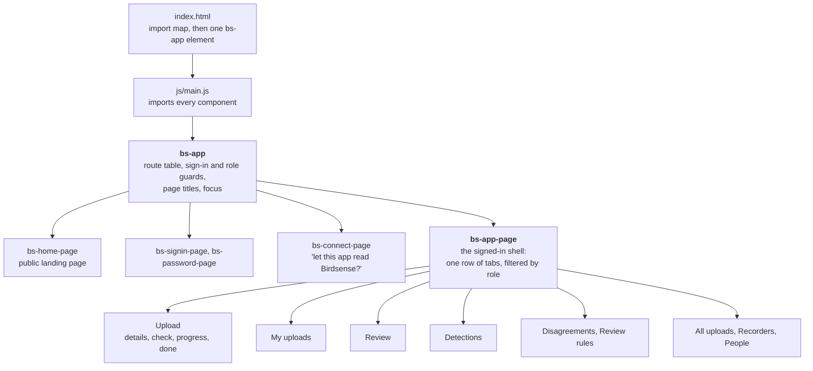

- **One component per file.** Every custom element is named `bs-...`, lives in
  `js/components/bs-....js`, extends a small `BaseElement`, and draws itself
  into its own shadow root. Re-rendering means rewriting that shadow root:
  there is no virtual DOM.
- **One shell for everyone.** Volunteers, reviewers and coordinators all work
  in `bs-app-page`. Its tab table names the role each tab needs, so a screen is
  built once and a coordinator uses the same Upload screen a volunteer does.
- **Real URLs.** Routes are paths (`/app/detections?species=Strix+varia`), not
  hash fragments, so a link to any screen can be shared or reloaded. The server
  answers `index.html` for any path without a file extension.
- **Styling through tokens.** `styles/app.css` defines design tokens as CSS
  custom properties (`--bs-*`), which pass into shadow roots. Shared building
  blocks (buttons, tables, form fields) are constructable stylesheets in
  `shared-styles.js`, inside a cascade layer so a component's own rules win.

The plain modules beside the components do the work that spans screens:

| Module | Does |
|---|---|
| `router.js`, `session.js`, `roles.js` | Navigation, who is signed in, and the same role rule the server enforces |
| `api.js` | `fetch` wrapper for `/api/v1`. Any 401 signs the browser out |
| `upload-flow.js` | The card upload, which spans four screens |
| `card-scan.js`, `wav.js` | Read a card folder into a day-by-day manifest, and read each WAV's header |
| `flac.js`, `flac-worker.js` | Compress WAVs to FLAC in Web Workers |
| `detection-list.js` | The Detections tab's pages of results, held so Previous and Next can step through them |
| `review-queue.js` | A card's bouts, in the order the Review tab works through them |
| `species-lookup.js` | BirdNET's species list, searchable by common or scientific name |

A handful of things come from outside the repo. Each one degrades on its own
rather than breaking the app:

| Dependency | From | Used for | Without it |
|---|---|---|---|
| tus-js-client | jsDelivr, pinned with an integrity hash | Card uploads | The upload page says the uploader didn't load |
| Leaflet | jsDelivr, through the import map | The recorders map | The map shows a note; the coordinate fields still work |
| OpenStreetMap tiles | OSM's public tile servers | Map backgrounds | No map imagery |
| IBM Plex Mono | Google Fonts | Monospaced text | A system fallback font |
| libflac.js | **Vendored** in `frontend/vendor/` | FLAC compression | Files go as WAVs, which works but takes twice as long |

## Uploading a card

A card is around 128 GB of hour-long WAV files, sent from volunteers' home
connections, which drop. The upload is built around that.

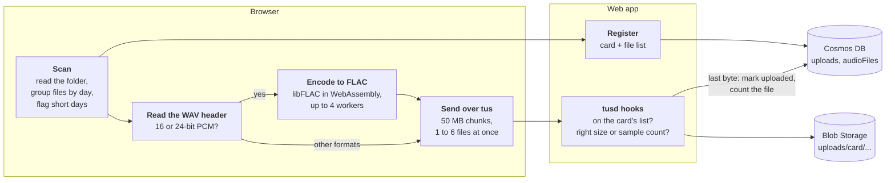

- **Resumable.** Each file is its own tus upload. If the connection drops or
  the volunteer pauses, a file picks up from its last stored chunk, not from
  the start. Chunks are 50 MB so each request finishes well inside the Azure
  ingress timeout.
- **Parallel on fast lines.** The browser measures the line first and sends
  one file per 20 Mbit/s, up to six, because the server pauses on each chunk
  while it hands it to Blob Storage.
- **Half the bytes.** Most WAVs are compressed to FLAC in the browser first:
  the same samples, losslessly, in roughly half the size. The first FLAC each
  tab makes is decoded again and checked against the original samples before
  any are trusted.
- **The server decides what counts.** A file is accepted only if it was on
  the card's registered list at that size. For a FLAC, the server checks that
  it holds exactly as many samples as the WAV did. A card's counts are the
  server's own tally of what it received, never numbers the browser reported.
  When the last file lands, the card moves to `processing`.
- **Through the app, not straight to storage.** Every byte passes through the
  web app, which costs some CPU and bandwidth, but keeps one upload path in
  development and production and keeps the card rules in Go.

Deeper reading: [PARALLEL-UPLOADS.md](PARALLEL-UPLOADS.md),
[CARD-COUNTS.md](CARD-COUNTS.md), and CLAUDE.md's *Card audio goes over tus*,
*A file's length is the whole integrity check* and *The browser sends WAVs as
FLAC*.

## Analysis

### Starting workers

Analysis is heavy (hours of CPU per card) and bursty (nothing for days, then a
card), so it runs in a Container Apps **job** that costs nothing when idle.
The web app decides how many workers to start.

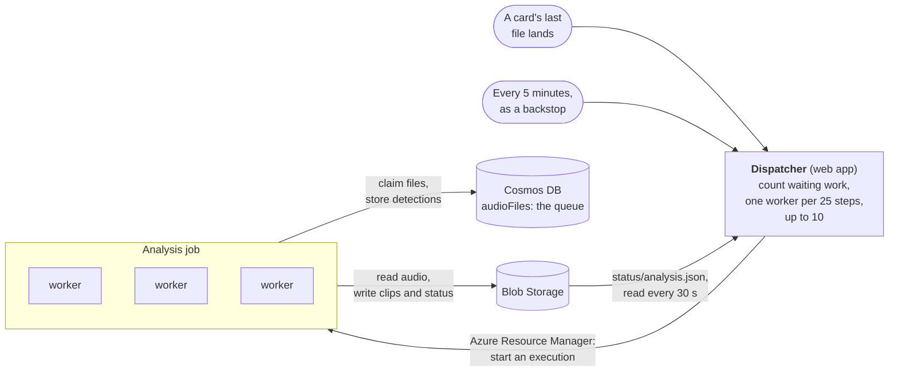

The web app's identity holds a custom Azure role that can start the job and
list its executions, and nothing else. Workers publish their status (for
example "BirdNET can't load") to a small file in storage, which the web app
shows on `/health` and the coordinator's card screens.

In development and under Docker Compose there is no job. The web app runs
the same queue in its own process, using the same code a worker runs.

### What one worker does

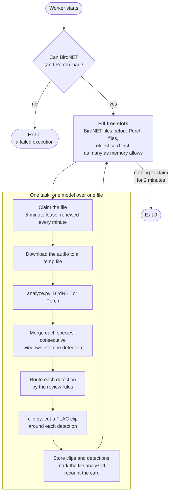

- **BirdNET runs as a Python subprocess.** BirdNET's maintained runtime is a
  Python package, so `internal/birdnet` runs `analyzer/analyze.py` and reads
  the JSON it prints, rather than binding a model runtime into Go. Clips are
  cut the same way, by `analyzer/clip.py`.
- **Claims make sharing safe.** A worker claims a file in a single
  compare-and-swap write, so two workers can't run the same file. A worker
  that dies holding a file loses it when its lease runs out, and another
  worker picks it up.
- **One bad file can't stall the queue.** A failed attempt puts the file back
  with a delay (30 s, then 60 s) while other files carry on, and the third
  failure marks it `failed`. A file BirdNET can't read fails at once.
- **Packing by memory.** A worker runs as many tasks at once as fit in its
  memory and cores. BirdNET takes about 260 MB and one core; Perch takes about
  2 GB.

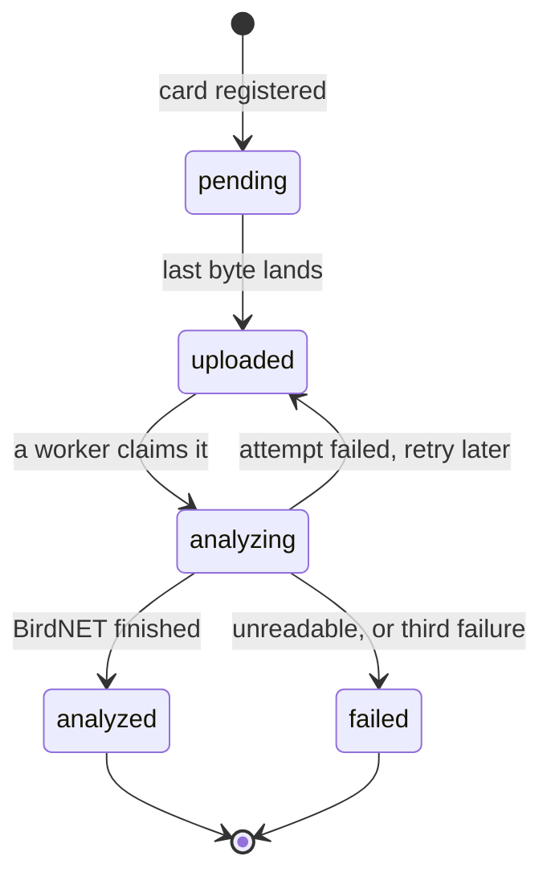

### Perch, the second opinion

With Perch switched on, every file also gets a run of Google's Perch v2 after
BirdNET. Its detections are stored beside BirdNET's, marked `model: "perch"`,
and are never merged with them or counted publicly: they exist to compare.
Perch has its own status on each file, so Perch failing doesn't hold up a
card's review. It costs about 17 times BirdNET's CPU, which is why it is off
by default.

Deeper reading: [ANALYSIS.md](ANALYSIS.md) (the job design and what was
measured), and CLAUDE.md's *The analysis queue is the database*, *Analysis
runs as a job* and *Perch is a second opinion*.

## Reviewing detections

A single recorder yields around **2,300 detections a day**, and most are
crows, geese and sparrows that are certainly there. Nobody can listen to all
of them, so review is built around three ideas:

1. **Rules decide what needs a person.** A birding expert keeps a table of
   review rules. Per species, it says whether BirdNET's word is taken
   (`accept`) or a person listens (`review`), each above a confidence floor
   (below which the detection is ignored).
2. **People hear bouts, not detections.** A *bout* is one species on one card,
   in detections no more than a few minutes apart. A reviewer hears its best
   clips and gives one verdict for all of it.
3. **Two listeners must agree.** A bout settles when two verdicts match.
   Three that don't match make it *disputed*, and a birding expert decides.

### Routing

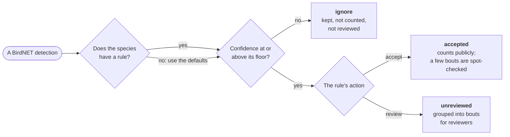

Routing happens in two places with the same function. A worker routes each
file's detections as it stores them. The web app's **Preparer** routes a
whole card again once BirdNET has finished it, and again whenever the rules
change. The Preparer also groups detections into bouts, picks a few
spot-check bouts from each accepted species, and rebuilds the card's summary.
Anything a person has already said is never undone by a rules change.

### Verdicts

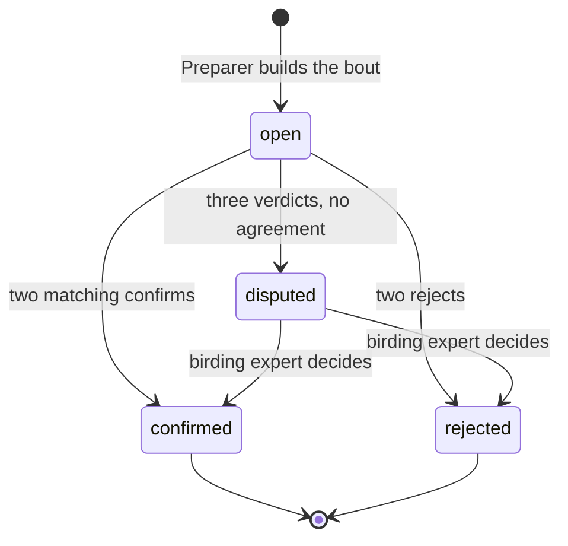

A spot-check bout settles on a single confirm. A reviewer can confirm a bout
as a *different* species ("that's a Barred Owl, not a Great Horned"). A
reviewer doesn't see other people's verdicts on a bout until they have given
their own. A birding expert can override any bout, settled or not.

When a bout settles, its verdict is copied to every detection in it. Each
detection then has one of four statuses:

| Status | Means | Counts publicly |
|---|---|---|
| `unreviewed` | Waiting for review, below its floor, or stored before rules existed | No |
| `accepted` | The rules accepted it, and nobody has said otherwise | Yes |
| `confirmed` | People confirmed its bout | Yes |
| `rejected` | People rejected its bout or its spot-check | No |

Until a birding expert saves the first table of rules, nothing is routed and
there are no bouts.

Deeper reading: [REVIEW.md](REVIEW.md), which has the numbers behind these
choices and the milestones the feature was built in.

## What the public sees

The landing page (`GET /api/v1/public/overview`, no sign-in) shows the year's
count of detections that count (accepted or confirmed) and every species heard
in the last week or month. A year of detections is far more than one request
should read, so the page reads one small **summary per card** instead.

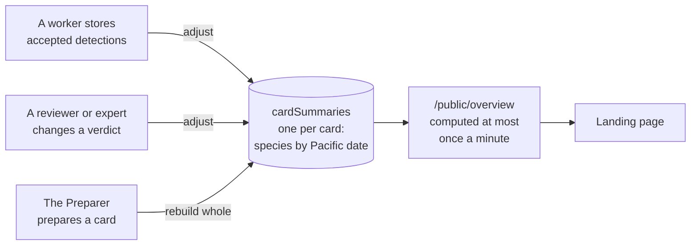

Every write that changes what counts adjusts the card's summary by the
difference. A whole rebuild during preparation corrects anything an
adjustment missed. The answer is cached for a minute, so a flood of
anonymous visitors costs one scan a minute, and a confirmation can take up
to a minute to show.

## The Detections tab and LLM tools

### The Detections tab

Reviewers browse every card's detections on one tab, filtered by species,
review status, confidence and dates, and sorted by time, species or
confidence. Opening a detection shows its clip, a spectrogram drawn in the
browser, and Previous and Next buttons that step through the list in its
current order.

Two limits keep a list affordable. The Go Cosmos SDK can't sort or page a
query that spans every card, so the server reads every match into memory to
sort it:

- **A window.** With no dates given, the list covers the last week, and the
  tab shows those dates in its date fields so the reviewer can widen them.
- **A ceiling.** A filter that matches more than a fixed maximum is answered
  with a message naming the filters that would narrow it, rather than
  exhausting the server's memory.

"Export as JSON" downloads every row the current filters match.

### MCP: LLM tools

An LLM tool, such as a claude.ai custom connector, can connect to
`/api/v1/mcp` and read detections as the person who connected it. Birdsense
is its own OAuth 2.1 server, because the tool has to be allowed by someone on
the roster, and neither Microsoft nor Google lets a client register itself.

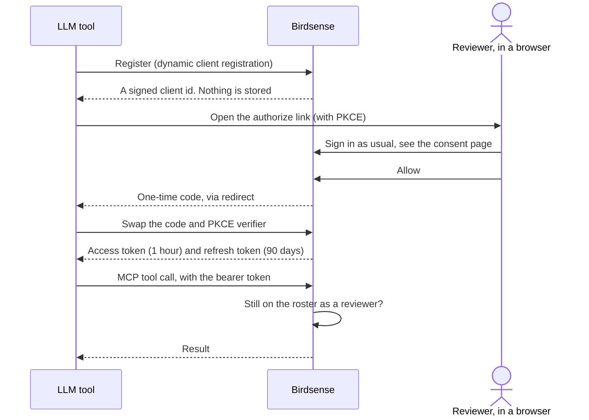

Four read-only tools, sized for a week at a time:

| Tool | Returns |
|---|---|
| `list_recorders` | Recorders, their positions, and when each one's latest recording started |
| `detection_summary` | A compact summary of a time range: totals, per-day and per-species counts, and which cards cover the range (so a quiet recorder isn't mistaken for fewer birds) |
| `find_detections` | The rows themselves, as CSV, for narrow questions; up to 500 |
| `detections_export` | A short-lived signed link to the whole range as a CSV file, for analysis in a code sandbox |

Like sessions, none of the OAuth state is stored: client ids, codes and tokens
are signed values. Removing someone from the roster, or taking away their
reviewer role, ends their connections at the next call.

## Signing in

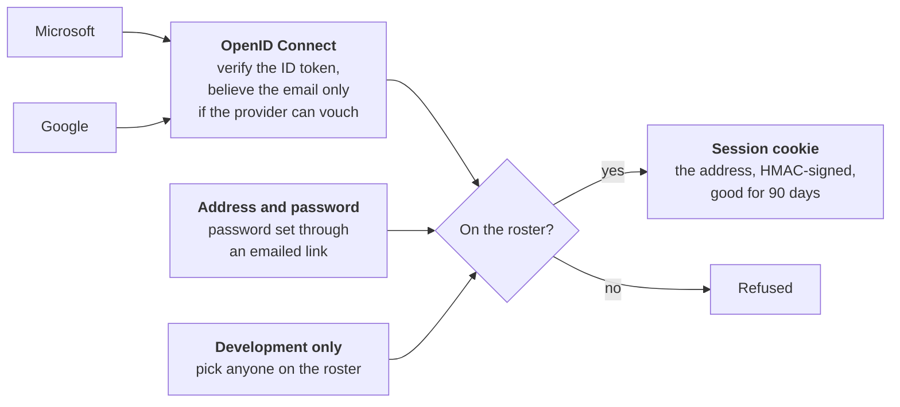

- **The roster is the allow-list.** A provider only proves which email address
  someone owns. What lets them in is a coordinator having added that address.
  Nobody registers themselves.
- **No session store.** The session cookie is the person's address, signed
  with a key from configuration. Rotating the key signs everyone out. Setting
  a new password, or being removed from the roster, ends that person's older
  sessions through one stored timestamp.
- **Passwords are optional.** They exist for people who don't want to use
  Microsoft or Google, and only where email is configured. Hashes are
  argon2id, kept in their own container away from the roster. Sign-in
  attempts and link requests are rate-limited.

Deeper reading: CLAUDE.md's *Sign-in is OpenID Connect* and *Password sign-in
is an emailed link and a hash*; DEPLOYMENT.md's *Sign-in*.

## Data

### Documents

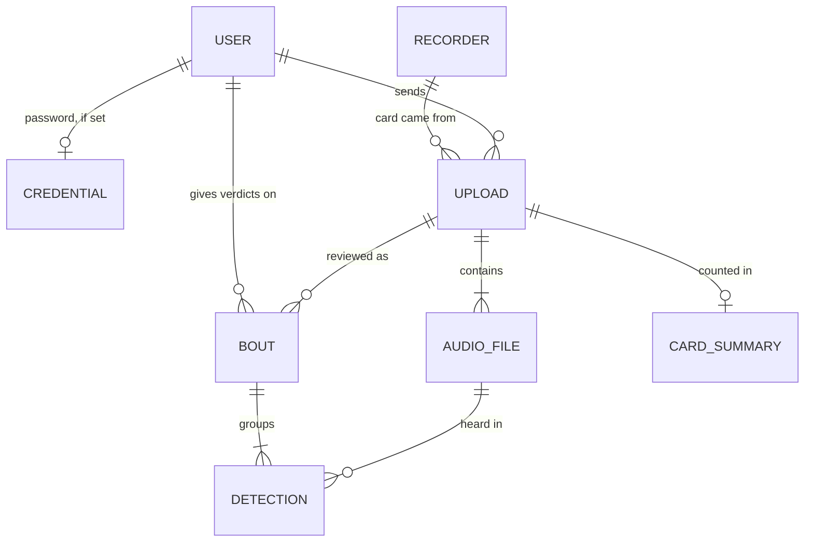

| Container | Holds | Partitioned by |
|---|---|---|
| `users` | The roster: names, addresses, roles | `id` |
| `credentials` | Password hashes, for those who set one | `id` |
| `recorders` | Listening stations and where they are | `id` |
| `uploads` | One per SD card: its status, counts and review progress | `id` |
| `audioFiles` | One per recording on a card, and its analysis status | `uploadId` |
| `detections` | One species heard in one stretch of one recording | `uploadId` |
| `bouts` | Groups of detections for review, with their verdicts | `uploadId` |
| `cardSummaries` | What counts on a card, by species and date | `id` |
| `settings` | The review rules (one document) | `id` |

Everything that grows with each card is partitioned by the card, because
nearly every question asked of it is about one card. A card is referred to by
a readable reference such as `OWL-20260907-SR02` (pulled 7 September 2026
from recorder SW-02).

**One `Store`, two backends.** `internal/db` defines a `Store` interface with
a named method for each read or write the app needs (`ListUploads`,
`UpdateDetection`, ...). Cosmos DB implements it in Azure, and a single JSON
file implements it in development. Filtering and sorting happen in Go,
written once, so the two backends give the same answers. Updates take a
"mutate" function that is retried on conflict, which is how rules like "a
count only goes up" stay correct when two writers race.

[SCHEMA.md](SCHEMA.md) describes every field.

### Files

All audio lives in one blob container, `audio`:

```text
audio/
├── uploads/{card}/{random}         a card's original recordings, deleted a month on
├── uploads/{card}/{random}.info    tusd's record of each upload
├── clips/{card}/{detection}.flac   a short clip per detection, kept for good
├── perf/{date}/{instance}/...      analysis performance records, deleted after 180 days
└── status/analysis.json            the analysis workers' latest status
```

Originals are the bulk of the storage (about 5.5 GB per recorder-day), and
nothing reads one after BirdNET has. Clips (about 0.7 GB per recorder-day)
are the only audio anyone listens to, so they stay until the card is deleted.

## Background work

| Loop | Runs in | Wakes | Does |
|---|---|---|---|
| **Dispatcher** | Web app | A card's last file lands; every 5 minutes | Counts waiting analysis and starts job workers |
| **Analysis queue** | Job workers (or the web app, in development) | While there is work | Runs BirdNET and Perch over files, stores detections and clips |
| **Preparer** | Web app | Startup; rules saved; every 5 minutes | Routes a finished card's detections, builds bouts and spot-checks, rebuilds its summary |
| **Retention sweep** | Web app | Every 6 hours | Deletes a finished card's original recordings 30 days after it arrived |
| **Deleter** | Web app | A card is deleted; every 5 minutes | Removes a deleted card's audio, clips and documents |

Every loop is written so that being stopped part way is harmless: the next
pass finishes what the last one started. Deleting a card is a status
(`deleting`) and a background sweep rather than a single request, because a
large card is tens of thousands of documents and takes minutes to delete.
See [DELETE-CARDS.md](DELETE-CARDS.md).

## Deployment

### Azure resources

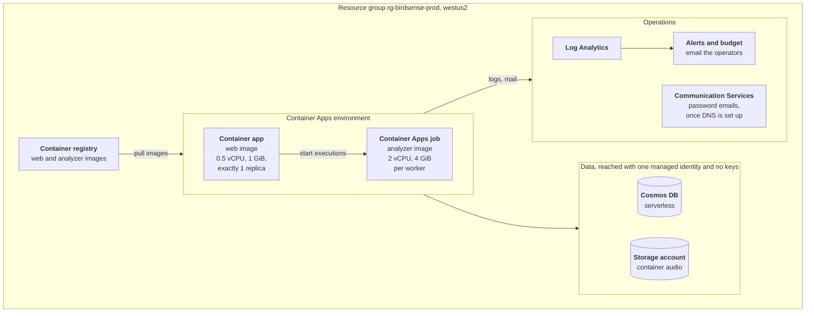

- **Exactly one web replica.** tusd keeps each upload's lock in memory, so
  every request for an upload must reach the same process. Several
  in-memory caches and rate limits rely on the same fact. Moving to more than
  one replica is a known, deliberate piece of future work.
- **No storage keys.** Both containers authenticate to Cosmos DB, Blob
  Storage and the registry as one managed identity, and key-based access is
  switched off. The secrets the app does hold are the session key, the OIDC
  client secrets and, once mail is set up, its access key.
- **Probes are split on purpose.** Liveness (`/health`) answers 200 no matter
  what, so Azure never restarts the app over a database outage it can't fix.
  Readiness (`/ready`) checks the database and storage, so a replica that has
  lost either stops getting traffic until it can reach them again.
- **Watched.** Alerts email the operators on replica restarts, a burst of
  server errors, BirdNET failing to load, Azure service or resource health
  events, and the monthly budget.

### Images

One `Dockerfile` builds three targets:

| Target | Contents | Used by |
|---|---|---|
| `web` | The Go binary and `frontend/` on Alpine. Tens of MB, no Python | The container app |
| `birdnet` | Python, BirdNET, TensorFlow (for Perch) and the models baked in. Nothing of Birdsense's own | The base for `analyzer`; rebuilt only when the Python requirements change |
| `analyzer` | `web`'s contents on top of `birdnet`, about 2 GB | The analysis job, and Docker Compose, where one container does everything |

### Deploying and rolling back

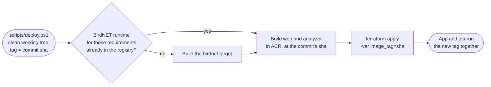

**Terraform owns what runs.** `infra/` describes the whole Azure stack, and a
deploy is "build this commit, then apply its tag". Nothing changes the running
app by hand, so `terraform plan` is always right about it. Rolling back is
applying an older tag, which skips the build
(`./scripts/deploy.ps1 -ImageTag a1b2c3d`). [ROLLBACK.md](ROLLBACK.md) lists
what a rollback does *not* undo, such as documents a newer version wrote.

**Checks.** GitHub Actions runs `gofmt`, `go vet`, the Go tests,
`govulncheck` and the frontend's `node --test` suite on every push and pull
request, and again weekly, so a new security advisory against unchanged code
still turns up.

Deeper reading: [DEPLOYMENT.md](DEPLOYMENT.md), which explains every resource
and setting, and [README.md](README.md) for the commands.

## Running it locally

Development is one process with no Azure at all:

```sh
cd backend && BIRDSENSE_DB=local go run ./cmd/server     # http://localhost:8080
```

| In Azure | In development |
|---|---|
| Cosmos DB | `backend/data/birdsense.json` |
| Blob Storage | `backend/data/audio/`, with the same names |
| Microsoft or Google sign-in | A picker of everyone on a placeholder roster |
| Emailed password links | Printed in the server's log |
| Analysis job workers | The same queue, in the server's own process (needs a Python venv with BirdNET) |

Frontend edits need only a browser reload. Go edits need a restart.
`HOST_PORT=8080 docker compose up --build` runs the whole thing, BirdNET
included, in one container. CLAUDE.md's *Running it* has the details, including
how to install BirdNET locally.

## Design principles, in short

The decisions behind all of this are written up in [CLAUDE.md](CLAUDE.md),
each with the reason for it and a *Revisit when* that says what would change
the answer. The recurring themes:

- **Small and boring on purpose.** One container for the site, no frontend
  framework or build step, no message queue (the database is the queue), no
  router library. A volunteer organization has to be able to keep this
  running for years.
- **One web replica, and honest about it.** Upload locks, caches and rate
  limits all live in memory. That is simple and cheap, and the docs flag every
  place that would have to change for a second replica.
- **Sign what you can, store what you must.** Sessions, OAuth clients and
  tokens, password links and export links are all signed values, so there is
  no session store to clean up or leak.
- **Pay for heavy compute only while it runs.** Analysis is a job that scales
  to zero. The always-on web app is sized to serve pages.
- **Keep what only accumulates in check.** Originals expire after a month;
  clips are kept and are the cost to watch.
- **Background work is restartable.** Every loop and every multi-step write
  can be cut off part way and finished by the next pass.
- **Measure, then decide.** Analysis records its own CPU and memory, and the
  design docs carry the measurements their decisions rest on.

## Where to read more

| Document | Read it for |
|---|---|
| [README.md](README.md) | Getting started, checks, and the deploy commands |
| [CLAUDE.md](CLAUDE.md) | Every architecture decision and its reasoning, the full route list, conventions |
| [SCHEMA.md](SCHEMA.md) | Every stored document and field, the blob layout, how the API maps onto storage |
| [DEPLOYMENT.md](DEPLOYMENT.md) | Every Azure resource and setting, sign-in, email and custom-domain setup |
| [ROLLBACK.md](ROLLBACK.md) | Going back to an earlier image, and what that doesn't undo |
| [ANALYSIS.md](ANALYSIS.md) | Running analysis as a job: the design, packing, claims, measurements |
| [REVIEW.md](REVIEW.md) | Review rules, bouts and verdicts: the design and its milestones |
| [PARALLEL-UPLOADS.md](PARALLEL-UPLOADS.md) | Why several files upload at once, with measurements |
| [CARD-COUNTS.md](CARD-COUNTS.md) | How a card's counts stay correct without recounting every file |
| [DELETE-CARDS.md](DELETE-CARDS.md) | Deleting a card in the background |
| [TODO.md](TODO.md) | What is left before the first release |
| [THIRD_PARTY_NOTICES.md](THIRD_PARTY_NOTICES.md) | Credits and licences, including BirdNET's non-commercial licence |
